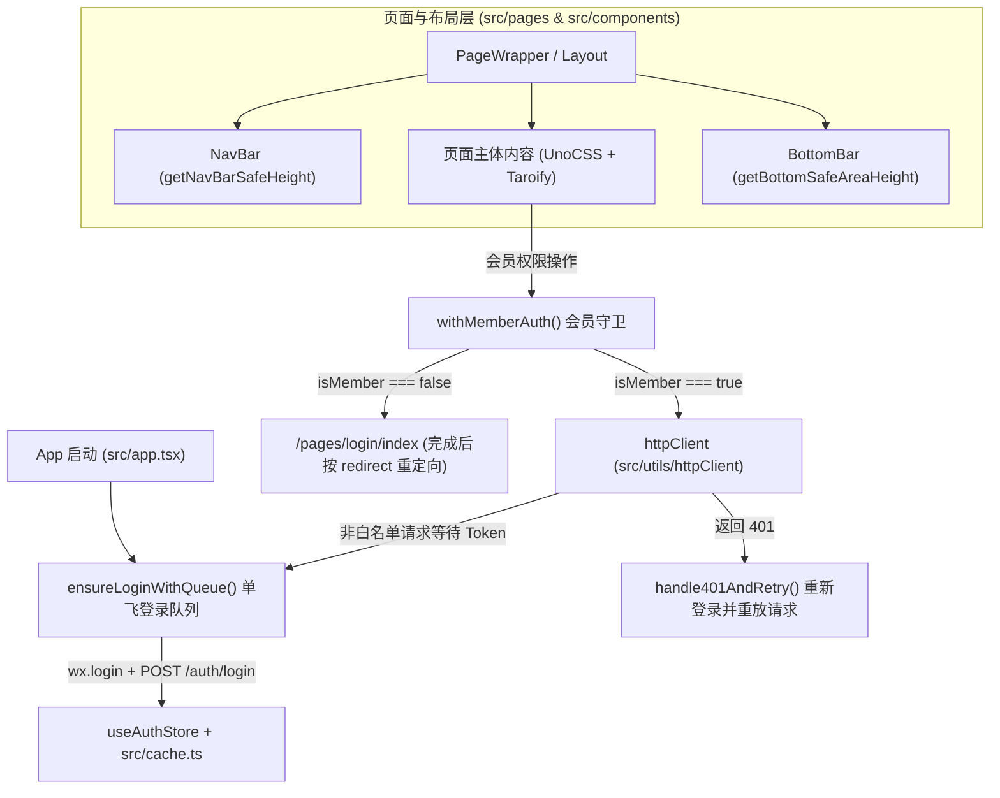

# Taro Starter

一个基于 **Taro 4.3 + React 18 + TypeScript 6 + Vite 4 + UnoCSS + Taroify** 的现代化多端小程序与 H5 企业级开发模板。

## ✨ 核心特性

- **现代编译与技术栈**：Taro `4.3.1`（`@tarojs/vite-runner` / Vite `4.x` 编译）+ React `18.3.1` + TypeScript `6.x`
- **原子化样式与 UI 组件库**：
  - 集成 **UnoCSS**（`@unocss/vite` + `unocss-applet` 小程序预设，支持 `rem2rpx` 自动转换与 Tabler / MDI / LineMD / Iconamoon 纯 CSS 图标集）
  - 集成 **Taroify (`@taroify/core` & `@taroify/icons`)** 组件库，并通过 `vite-plugin-style-import` 实现组件样式自动按需引入
- **分层状态管理**：
  - **客户端全局状态**：`Zustand` v5（`src/store/`）配合内存 (RAM) + 本地存储 (Storage) 强类型双层缓存 `cache`（`src/cache.ts`）
  - **服务端异步状态**：`@tanstack/react-query` v5（`src/lib/react-query.ts`）+ 模块化 `createApi` 工厂（`src/api/`）
- **单飞（Single-Flight）请求队列与无感鉴权**：
  - 并发请求通过 `ensureLoginWithQueue()` 单飞队列挂起，全局仅触发唯一一次 `wx.login -> /auth/login`
  - 支持 API 白名单与 `{ noAuth: true }` 放行，遇到 `401` 自动重登并无感重放原请求
- **会员权限守卫与路由封装**：
  - 提供 `withMemberAuth` 高阶函数拦截非会员操作，自动跳转独立登录页 `/pages/login/index` 并支持登录成功后原路重定向（自动识别 TabBar 页与普通页）
  - 提供强类型路由跳转工具 `navigateTo` / `redirectTo` / `switchTab` / `navigateBack` / `reLaunch`（`src/utils/route.ts`）
- **全局页面容器与异形屏安全区适配**：
  - 统一 `<PageWrapper>`（别名 `<Layout>`）布局容器，内置自定义顶部导航栏 `NavBar` 与贴底导航栏 `BottomBar`
  - 顶部胶囊安全高度与底部 Home Indicator 安全区高度计算带内存级单例缓存（`src/utils/safeArea.ts`）
- **CI 自动构建上传与 AI 辅助开发**：
  - 内置 `pnpm ci:upload`（`script/ci/upload.ts`），基于 `miniprogram-ci` 自动构建、上传微信小程序并推送企业微信 Webhook 通知
  - 内置 Taroify 官方离线 AI 文档库（`docs/taroify/`）与项目级 AI 上下文规范（`AGENTS.md` / `CLAUDE.md` / `GEMINI.md` / `skills/taroify/SKILL.md`）

---

## 🛠️ 环境要求

- **Node.js**: `>= 18`
- **包管理器**: 强制使用 `pnpm`（当前锁版本 `pnpm@10.33.2`）

---

## 📋 新项目初始化配置清单 (Checklist)

> 当基于本模板创建新项目时，请对照以下清单逐项替换项目专属配置：

| 分类                | 配置文件 / 路径                                                                                                                                                                  | 配置项                                    | 说明与示例                                                                                               |
| :------------------ | :------------------------------------------------------------------------------------------------------------------------------------------------------------------------------- | :---------------------------------------- | :------------------------------------------------------------------------------------------------------- |
| **基础信息**        | [`project.config.json`](./project.config.json)                                                                                                                                   | `appid`, `projectname`                    | 微信小程序 AppID（测试/体验版）与微信开发者工具项目名称                                                  |
|                     | [`package.json`](./package.json)                                                                                                                                                 | `name`, `description`                     | 项目包名与简要描述                                                                                       |
|                     | [`src/app.config.ts`](./src/app.config.ts)                                                                                                                                       | `navigationBarTitleText`, `tabBar`        | 全局默认顶部标题与底部 TabBar 路由/文案配置                                                              |
| **多环境域名**      | `.env.development`<br>`.env.test`<br>`.env.production`                                                                                                                           | `TARO_API_BASE_URL`<br>`TARO_S3_BASE_URL` | 各环境的业务 API 接口域名与 S3/OSS 静态资源域名（注意以 `TARO_` 开头）                                   |
| **CI 自动化上传**   | [`script/ci/`](./script/ci/)                                                                                                                                                     | `private.{appid}.key`                     | 从微信公众平台「开发管理 - 开发设置 - 小程序代码上传密钥」下载并重命名放置，同时在后台配置上传 IP 白名单 |
|                     | [`script/ci/upload.ts`](./script/ci/upload.ts)                                                                                                                                   | `DEFAULT_WECHAT_WEBHOOK_KEY`              | 企业微信通知机器人 Webhook Key（可硬编码默认值或配置环境变量 `WECHAT_WEBHOOK_KEY`）                      |
| **合规与协议**      | [`src/pages/agreements/privacy-policy.tsx`](./src/pages/agreements/privacy-policy.tsx)<br>[`src/pages/agreements/user-agreement.tsx`](./src/pages/agreements/user-agreement.tsx) | 公司主体名称、邮箱、电话、生效日期        | 替换 `"XXX有限公司"`、`_EMAIL_`、`_PHONE_`、`_ADDRESS_` 为实际公司主体信息                               |
| **数据埋点 (可选)** | [`src/sr.config.ts`](./src/sr.config.ts)                                                                                                                                         | `token`, `appid`                          | 腾讯有数 SDK 配置。若不需要，可在 [`src/app.tsx`](./src/app.tsx) 中保持 `initSRSDK(false)`               |

---

## 🚀 快速开始

### 1. 安装依赖

```bash
pnpm install
```

### 2. 环境变量配置

项目中的 `.env` 及 `.env.*` 文件不纳入 Git 管理，仓库提供 `.env.example` 作为配置模板。启动或构建时通过 `--env-prefix TARO_` 自动加载对应模式下的 `TARO_*` 变量：

```bash
# 创建默认环境变量文件
cp .env.example .env

# 按需创建对应环境的配置文件
cp .env.example .env.development
cp .env.example .env.test
cp .env.example .env.production
```

`.env.example` 配置项说明：

```ini
# 小程序 AppID（可选）
# TARO_APP_ID="小程序appid"
# 业务 API 基础域名
TARO_API_BASE_URL="https://api.example.com"
# S3 静态资源基础域名
TARO_S3_BASE_URL="https://s3.example.com"
```

> **注意**：严禁在 `src/` 业务代码中访问未在 `.env` 中定义的 `process.env.XXX` 变量，小程序端无 Node.js 全局 `process` 对象。

### 3. 本地开发

```bash
# 微信小程序（默认 development 模式，读取 .env.development）
pnpm dev:weapp

# 微信小程序指定 test 环境（读取 .env.test）
pnpm dev:weapp --mode test

# H5 开发模式
pnpm dev:h5
```

### 4. 生产构建与 CI 上传

```bash
# 微信小程序生产构建（读取 .env.production）
pnpm build:weapp

# H5 生产构建
pnpm build:h5

# 自动构建并上传微信小程序代码（需在 script/ci/ 放置 private.{appid}.key）
pnpm ci:upload

# 同步更新本地 Taroify AI 离线文档（llms.txt & llms-full.txt）
pnpm docs:taroify

# 代码规范检查与自动修复
pnpm lint
pnpm lint:fix
```

---

## 📂 目录结构与架构全景

```text
├── .env.example                  # 环境变量配置示例
├── config/
│   ├── index.ts                  # Taro Vite 编译主配置（UnoCSS、vite-plugin-style-import、taroViteCompatPlugin）
│   ├── dev.ts                    # 开发环境配置（开启 mini.debugReact 兼容 React 18 开发态）
│   └── prod.ts                   # 生产环境构建配置
├── docs/
│   └── taroify/                  # Taroify 官方 AI 文档本地持久化目录（由 pnpm docs:taroify 更新）
│       ├── llms.txt              # Taroify 轻量文档索引
│       └── llms-full.txt         # Taroify 全量离线组件文档合集
├── script/
│   └── ci/
│       ├── upload.ts             # 微信小程序 CI 自动构建、上传与企微 Webhook 通知脚本
│       └── README.md             # CI 上传脚本配置与使用说明
├── skills/
│   ├── system/run-workflow/      # 多 Agent 工作流编排 Skill
│   └── taroify/SKILL.md          # Taroify 组件库检索与按需引入规范 Skill
├── src/
│   ├── app.config.ts             # Taro 全局配置（pages 路由、tabBar 底部栏、custom 导航栏）
│   ├── app.tsx                   # 应用入口（QueryClientProvider 挂载、启动触发 ensureLoginWithQueue）
│   ├── app.scss                  # 全局样式与 CSS Variables 主题设计令牌
│   ├── cache.ts                  # 内存 (RAM) + 本地存储 (Storage) 强类型双层缓存实例
│   ├── api/
│   │   ├── core/                 # createApi 工厂与 React Query queryKeys 管理
│   │   ├── endpoints/            # 模块化接口端点定义（user.ts, wechat.ts）
│   │   ├── hooks/                # React Query 业务 Hooks（useUser.ts, useWechat.ts）
│   │   ├── models/               # 领域与接口数据模型类型
│   │   ├── wechat.ts             # 微信静默登录接口（POST /auth/login）
│   │   └── mockAuth.ts           # 会员登录/注册 Mock 接口实现
│   ├── components/
│   │   ├── PageWrapper/          # 全局页面布局容器（默认 h-full w-full，集成顶部 NavBar 与底部 BottomBar）
│   │   ├── Layout/               # PageWrapper 的语义化别名导出
│   │   ├── NavBar/               # 自定义顶部导航栏组件
│   │   ├── BottomBar/            # 自定义贴底导航栏组件（默认 4 个 Tab 项、安全区适配与未读红点预留）
│   │   ├── PrivacyPolicyPopup/   # 首次启动隐私保护指引弹窗组件（基于 @taroify/core Popup）
│   │   ├── S3Image/              # S3 / 普通图片自适应组件（自动拼接 TARO_S3_BASE_URL）
│   │   ├── InfiniteScroll/       # 无限滚动列表容器组件
│   │   ├── Pagination/           # 分页器组件
│   │   ├── InputPopup/           # 输入型弹窗组件
│   │   ├── KeyboardAdaptivePopup/# 键盘高度自适应弹窗组件
│   │   ├── FloatingButton/       # 悬浮按钮组件
│   │   ├── ListItem/             # 通用列表项组件
│   │   └── LoadingAnimation/     # 加载动画组件
│   ├── constants/
│   │   ├── routes.ts             # RouteNames 枚举、PAGES 路径映射、TAB_BAR_ROUTES 底部导航路由集合
│   │   ├── routeTypes.ts         # 各路由强类型参数定义 RouteParamConfig
│   │   ├── scene.ts              # 小程序场景值常量
│   │   └── themes.ts             # 主题配置常量
│   ├── hooks/                    # 通用自定义 Hooks（useDebounce, useFormValidation, usePagination, useTheme）
│   ├── lib/
│   │   └── react-query.ts        # TanStack QueryClient 全局实例配置
│   ├── pages/
│   │   ├── index/                # 首页（Tab 1，含隐私弹窗拦截、脚手架特性卡片与架构专栏）
│   │   ├── discover/             # 发现页（Tab 2，含生态探索、分类标签与精选卡片占位）
│   │   ├── messages/             # 消息中心页（Tab 3，含系统通知分类与一键已读演示）
│   │   ├── profile/              # 个人中心页（Tab 4，含用户信息卡片、密码修改与系统设置）
│   │   ├── login/                # 独立会员登录/注册页（支持 redirect 重定向与 shouldReturn 返回控制）
│   │   └── agreements/           # 隐私保护政策与用户服务协议页
│   ├── store/
│   │   └── useAuthStore.ts       # Zustand 全局认证与会员状态 Store（accessToken, isMember, account）
│   └── utils/
│       ├── httpClient/
│       │   ├── index.ts          # 统一请求出口（http.get/post/put/delete/patch, createFetch）与 401 自动重放
│       │   ├── apiClient.ts      # 底层 Taro.request 封装
│       │   ├── constants.ts      # 环境域名映射配置
│       │   └── auth/
│       │       ├── requestQueue.ts # API 白名单管理 + 单飞登录等待队列（ensureLoginWithQueue）
│       │       ├── interceptor.ts  # 请求头 Bearer Token 注入与 handle401AndRetry
│       │       └── index.ts        # saveAuthData 同步写入 Store 与 Cache
│       ├── cache/                # 双层缓存核心实现（RAM + Storage）
│       ├── s3.ts                 # S3 资源地址拼接工具（resolveS3Url / getS3Url）
│       ├── safeArea.ts           # 顶部导航栏与底部安全区域高度计算（带内存单例缓存）
│       ├── memberGuard.ts        # 非会员操作拦截器（withMemberAuth / checkMemberOrRedirect）\n│       └── route.ts              # 类型安全的路由跳转工具函数
├── AGENTS.md / CLAUDE.md / GEMINI.md # AI 助手必读架构上下文文档
└── package.json                  # 项目依赖与脚本
```

---

## 🏗️ 核心架构说明



### 1. 请求与鉴权（Single-Flight 队列 + 401 自动重放）

- 所有非白名单请求在发送前通过 [`ensureLoginWithQueue()`](file:///Users/cy/Documents/Code/Dev/Fe/taro-starter/src/utils/httpClient/auth/requestQueue.ts) 检查登录态。若尚未完成首次登录或正在重新登录，并发请求全部进入队列挂起，全局仅执行一次 `Taro.login() -> /auth/login`，成功后自动释放队列并注入 `Authorization: Bearer <access_token>`。
- 当接口返回 `401` 时，[`httpClient`](file:///Users/cy/Documents/Code/Dev/Fe/taro-starter/src/utils/httpClient/index.ts) 自动调用 `handle401AndRetry()` 刷新 Token 并重放原请求一次。

### 2. 后端登录接口契约规范 (Login API Contract)

> 💡 **重要说明**：本项目为**纯前端开源模版，不配套后端服务**。开发者接入自建后端或 Mock 服务时，请确保微信静默登录接口（默认 `POST /auth/login`，可通过 `src/api/wechat.ts` 调整）满足以下返回结构契约。

#### 接口定义
- **接口路径**: `POST /auth/login`
- **请求方式**: `POST`
- **请求参数**:
  ```json
  {
    "code": "091Xp20w3bXxxx" // Taro.login() 返回的临时登录 code 凭证
  }
  ```

#### 真实响应数据结构 (Response Example)
```json
{
  "code": 200,
  "message": "success",
  "data": {
    "access_token": "asdPkKNyI",
    "refresh_token": "asdsadv-vo",
    "expires_at": "2026-10-30T08:38:50.233352154Z",
    "user_validated": true,
    "user_authed_at": "2025-12-17T10:00:28.634029Z"
  }
}
```

#### 响应字段详细说明
| 字段路径 | 数据类型 | 必填 | 说明 |
| :--- | :--- | :--- | :--- |
| `code` | `number` | 是 | 业务响应状态码，`200` 代表请求处理成功 |
| `message` | `string` | 是 | 响应状态描述，如 `"success"` |
| `data.access_token` | `string` | 是 | 核心访问令牌（Bearer Token）。登录成功后前端将自动缓存并于后续所有非白名单请求中注入请求头 `Authorization: Bearer <access_token>` |
| `data.refresh_token` | `string` | 否 | 刷新令牌，用于在 Access Token 过期时无感续期（可选） |
| `data.expires_at` | `string` | 否 | Access Token 到期时间（ISO 8601 标准时间字符串，如 `"2026-10-30T08:38:50.233352154Z"`） |
| `data.user_validated` | `boolean` | 否 | 用户实名/会员验证状态。`true` 时前端将自动赋予会员/已认证权限，同步写入 `useAuthStore` 与持久化存储中，用于驱动 `withMemberAuth` 守卫 |
| `data.user_authed_at` | `string` | 否 | 用户完成实名或平台授权的时间戳（ISO 8601 标准格式） |

### 3. 会员权限守卫（`withMemberAuth`）

- 页面内需要会员权限的按钮或回调只需使用 [`withMemberAuth(fn)`](file:///Users/cy/Documents/Code/Dev/Fe/taro-starter/src/utils/memberGuard.ts) 包裹。
- 未开通会员时自动拦截并跳转至 [`/pages/login/index`](file:///Users/cy/Documents/Code/Dev/Fe/taro-starter/src/pages/login/index.tsx)，携带当前路由作为 `redirect` 参数；登录成功后自动识别目标页是否为 TabBar 页面并完成原路跳转。

### 4. Taroify 按需样式与 AI 文档检索

- [`config/index.ts`](file:///Users/cy/Documents/Code/Dev/Fe/taro-starter/config/index.ts) 已集成 `vite-plugin-style-import`，在业务代码中直接 `import { Button, Popup } from "@taroify/core"` 即可自动按需打包对应组件样式至 `vendors.wxss`。
- 仓库内已持久化 [`docs/taroify/llms.txt`](file:///Users/cy/Documents/Code/Dev/Fe/taro-starter/docs/taroify/llms.txt) 与 [`docs/taroify/llms-full.txt`](file:///Users/cy/Documents/Code/Dev/Fe/taro-starter/docs/taroify/llms-full.txt)，AI 助手可离线精准查阅所有 Taroify 组件 Props 与示例。

---

## 📄 开源协议

[MIT](./LICENSE)
